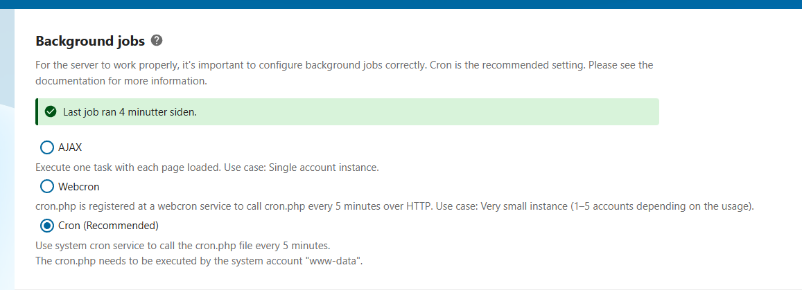
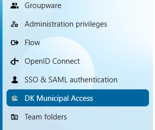
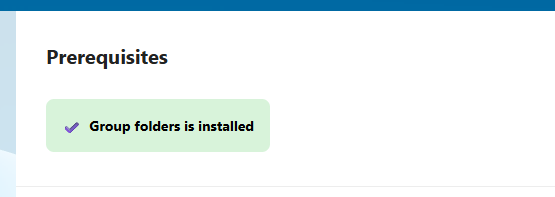
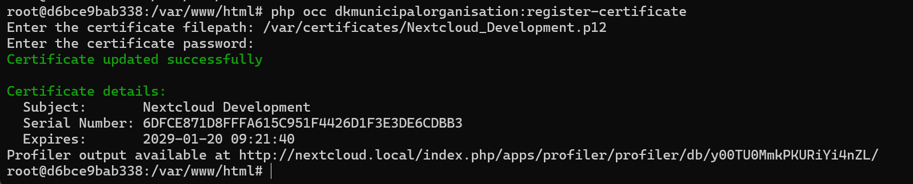
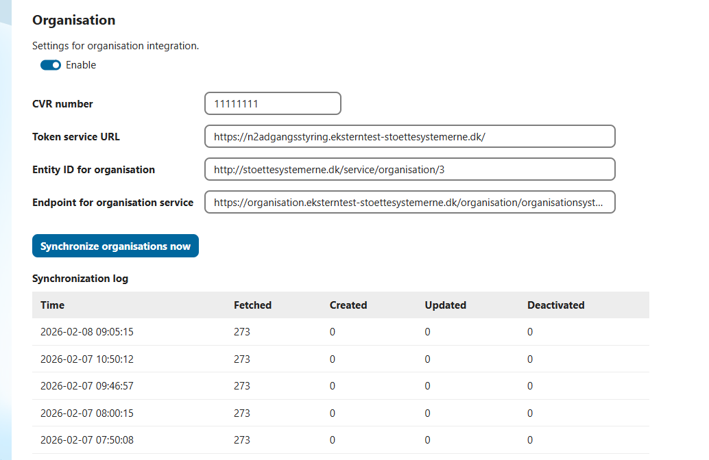
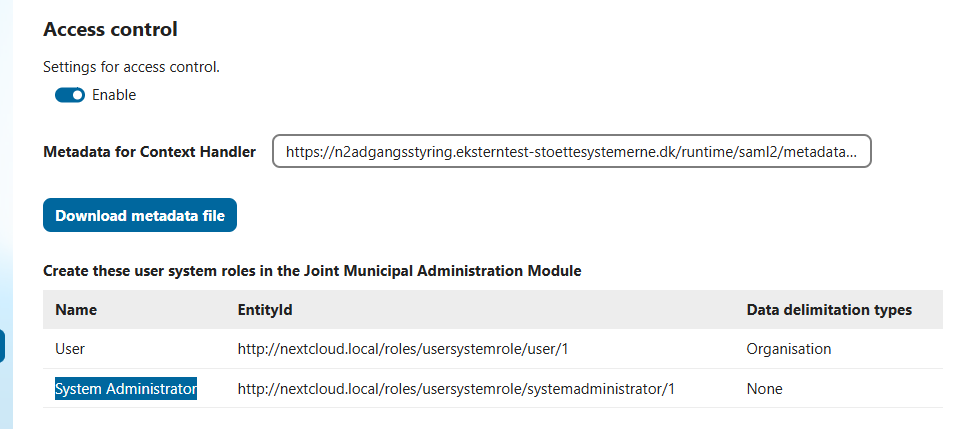

# Danish Municipal Organisation and Access Control

In Denmark, the organisation **KOMBIT** provides shared service integrations for public municipalities.

This app integrates Nextcloud with two core municipal services:

- **Organisation structure**
- **Access control via SAML login flow**

To use this app, you must follow the **Connection Guide** for both *Usable Systems* and *User-facing Systems*, available here:  
[Connection Guide](https://digitaliseringskataloget.dk/tilslutningsguide)

Also, we provide a comprehensive  installation guide in Danish here:
[Installation and Configuration Guide](https://lamotech.dk/nextcloud/dkmunicipalorganisation/Installation%20og%20konfiguration%20af%20DK%20Kommunal%20Adgang%20til%20Nextcloud.pdf)

---

## Requirements

This app requires the **Team Folders** app to be installed:

- https://apps.nextcloud.com/apps/groupfolders

The organisation structure integration automatically creates a **team folder for each department**, allowing users to collaborate on documents.

Additionally, your Nextcloud instance **must be configured to run background jobs using cron**.



---

## Configuration

### System Certificate

The integrations require an **official system certificate** (`.p12` file) issued by the Danish government.

Steps:
1. Acquire the certificate via the **MitID Business** portal:  
   https://mitid-erhverv.dk/
2. Copy the certificate file to the Nextcloud server
3. Register the certificate in Nextcloud (see instructions below)

---

### Register IT System at Serviceplatformen

To use the integration, your Nextcloud system must be registered as an **IT system** in the Serviceplatformen administration portal.

You must upload the **public key** from your system certificate.

Administration portals:
- **Test**: https://admin-test.serviceplatformen.dk/
- **Production**: https://admin.serviceplatformen.dk/

---

### Organisation Structure Integration

Using the organisation structure sync requires a **service agreement** with Serviceplatformen for the organisation service (**SF1500**).

---

### Access Control

For SAML-based access control, you can download a **SAML metadata file** from the app’s configuration page in Nextcloud.  
This metadata must be uploaded to the **User-facing System** in the KOMBIT administration portal.

---

## Settings Page in Nextcloud

Once the app is installed and enabled, you can find the settings page under:

**Administration → DK Municipal Access**



---

### Prerequisites

The app first checks whether the **Team Folders** app is installed and enabled.

If it is missing, you must install and enable it before continuing.



---

### System Certificate Registration

Register the system certificate acquired from **MitID Business**.

1. Copy the `.p12` certificate file to the server and restrict access to it, so only the web server user can read it:

```bash
chown www-data:www-data /path/to/certificate.p12
chmod 600 /path/to/certificate.p12
```

2. From the Nextcloud installation directory, run:

```bash
sudo -u www-data php occ dkmunicipalorganisation:register-certificate
```
3. Provide:
- Path to the certificate file
- Certificate password

4. Delete the original `.p12` file. The command offers to do this for you.

**How the certificate is stored**

- The certificate file is copied into the app's own data folder in the Nextcloud data directory (`appdata_<instanceid>/dkmunicipalorganisation/certificates/`). After registration, the app does not use the original file.
- The certificate password is stored **encrypted** in the database using Nextcloud's built-in encryption (`OCP\Security\ICrypto`). The key is derived from `secret` in `config/config.php`.
- The password and file location are never sent to the browser.

Because the password can be decrypted with `secret` from `config.php`, protect `config.php`, the data directory and your backups of them accordingly. If `secret` is ever changed, register the certificate again.

When upgrading from version 1.2.2 or earlier, existing passwords are encrypted automatically and the certificate file is copied into the app data folder. You can then delete the original file. If you suspect that a database backup containing the plaintext password has been exposed, renew the system certificate in MitID Business.





### Organisation Synchronisation



Enable the organisation synchronisation service and configure the following settings:

| Setting | Description |
|------|------|
| CVR number | Your organisation’s CVR number. For testing with Korsbæk Kommune, use 11111111 |
| Token service URL | Test: https://n2adgangsstyring.eksterntest-stoettesystemerne.dk/, Production: https://n2adgangsstyring.stoettesystemerne.dk/ |
| Entity ID for organisation | Current verson: http://stoettesystemerne.dk/service/organisation/3 |
| Endpoint for organisation service | Test: https://organisation.eksterntest-stoettesystemerne.dk/organisation/organisationsystem/6/, Production: https://organisation.stoettesystemerne.dk/organisation/organisationsystem/6/ |

After saving the configuration, run the **initial synchronisation** by clicking:

**“Synchronize organisations now”**

When enabled, synchronisation runs **once daily just after midnight**.


### Access control



When Access Control is enabled, users must authenticate using a SAML login flow:

Nextcloud → KOMBIT Context Handler → Customer Identity Provider (IdP)

The Context Handler enriches the SAML assertion with privileges that define:
- The user’s role in Nextcloud
- Which department team folders the user can access

You must specify the URL for the Context Handler metadata:
- Test: https://n2adgangsstyring.eksterntest-stoettesystemerne.dk/runtime/saml2/metadata.idp?samlprofile=nemlogin3
- Production: https://n2adgangsstyring.stoettesystemerne.dk/runtime/saml2/metadata.idp?samlprofile=nemlogin3


#### User Roles
Two roles are supported:

| User Role | Description |
|------|------|
| User | Access is limited by organisational data. Users are granted access only to their department’s team folders |
| System Administrator | Granted access to Nextcloud’s built-in admin group and full administrative privileges |

#### Direct Login (Local Users)
It is still possible to log in using local Nextcloud users by visiting:

**https://&lt;domain&gt;/index.php/login?direct=1**


#### SAML Metadata
By clicking “**Download metadata file**”, you can download the SAML metadata required for configuration of the **User-facing System** in the KOMBIT administration portal.

---

## Troubleshooting
### Tracing
You can enabling tracing with this command

**php occ dkmunicipalorganisation:trace-enable**

A trace file will be created in the data directory:

&lt;datadir&gt;/dkmunicipalorganisation.log

You will for example be able to see the user privilege from the SAML token.

Disable tracing again with this command

**php occ dkmunicipalorganisation:trace-disable**

---

### Other useful commands

### FetchOrganisationsCommand

**php occ dkmunicipalorganisation:fetch-orgs**

Will fetch the list of organisations from the integration and print them in the command window. The database is not changed by this command but it is useful to test the integration.

### ShowSyncLogCommand

**php occ dkmunicipalorganisation:show-sync-log [limit]**

Shows the latect entries from organisation sync log. You can specify a limit of how many entries you want to list. Default is 10.

### ValidateOrganisationsCommand

**php occ dkmunicipalorganisation:validate-org**

Loops through the organisations and validate that team folders and access groups exists. Reports a lists of any mismatches.


